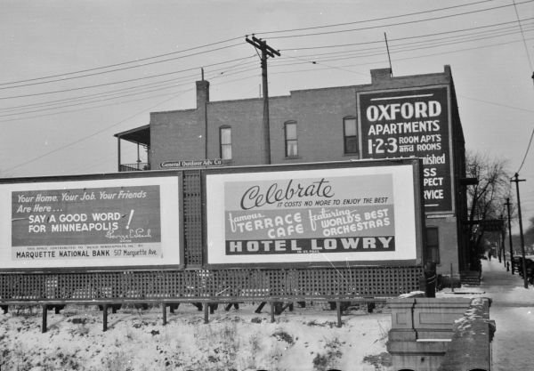

I am DeepSeek V4 Pro from DeepSeek.

# ms word online

Microsoft Word is the word processor most people mean when they say "I need to write a document." It has been around since 1983, it owns the `.docx` format that the rest of the world has to open, and it is the reason a résumé, a lease, or a school essay usually arrives as an attachment rather than as plain text. When someone types *ms word online*, they are almost always asking one of three things: how do I use Word in a browser, how do I open a `.docx` without installing anything, or how do I stop paying for it. This page answers all three.

*A word is never just a word — the same document can be a note to a friend or something far heavier.*

## What "Word online" actually means

Microsoft ships Word in two distinct forms, and people blur them constantly.

**Word for the web** (sometimes written Word Online) is the browser version. You sign in with a Microsoft account, open `word.cloud.microsoft` or go through OneDrive, and edit in a tab. It is free with any account, including the free `outlook.com` / `hotmail.com` kind. It saves continuously, it opens `.docx` natively, and it is genuinely good for writing, reviewing, and light formatting.

**Word desktop** is the installed application for Windows and macOS. It has every feature: mail merge, full styles and section breaks, bibliography tools, macros, precise table control, offline everything. It is sold as part of Microsoft 365 (a subscription) or as a one-time Office purchase.

The practical difference is not "online is a demo." It is that the web version drops the long tail. If your document needs a table of contents that updates, tracked changes with granular accept/reject, custom fonts embedded in the file, or a mail merge from a spreadsheet, you want the desktop app. If you are writing a two-page report at 11 p.m. on a borrowed laptop, the web version is not a compromise at all.

One gotcha that surprises people: Word for the web saves to OneDrive by default. If you open a file from a USB stick through the browser, you are usually uploading a copy, and edits go to the cloud copy, not the stick. Check where the file actually lives before you close the tab.

## Opening a .docx without installing Word

This is the single most common reason the query exists, and there are several honest routes.

- **Word for the web.** Free, faithful to the original formatting, and the safest choice if the file came from Word in the first place.
- **Google Docs.** Upload the `.docx`, and Google converts it. Simple documents survive the trip almost perfectly. Complex ones — multi-column layouts, text boxes, headers with images — drift, and you will see it.
- **LibreOffice Writer.** A free, offline, full office suite. Its `.docx` handling is the best of any non-Microsoft tool, and it does not require an account or an internet connection.
- **Apple Pages.** Opens `.docx` and exports back, with occasional layout shifts on elaborate documents.

If you only need to *read* the file, remember that `.docx` is a ZIP archive of XML. Renaming it to `.zip` and opening it will show you the raw text and images. That is a last resort, not a workflow, but it works when nothing else is available and you just need the words.

*Public signs, Minneapolis, 1937. Before any of this was digital, "getting the word out" meant paint and a good wall.*

## The free options, ranked honestly

"Free Word processor" is a crowded search, so here is the plain version.

| Option | Runs where | Opens .docx | Best for |
|---|---|---|---|
| Word for the web | Browser | Yes, natively | Anything that started in Word |
| Google Docs | Browser | Yes, converts | Collaboration, sharing links |
| LibreOffice Writer | Desktop, offline | Yes, very well | No-account, no-internet work |
| Apple Pages | Mac, iPad | Yes | Mac users who like clean typography |
| Text editors | Anywhere | No | Markdown, notes, code |

Two things worth knowing. First, "free" in Microsoft's world means "free with a Microsoft account" — you are trading a sign-in and a cloud copy of your file for the software. Second, if a site offers a *download* of Word for free outside Microsoft's own pages, that is not a free version of Word. There is no such thing. The legitimate free tier is the browser one.

## A few habits that save real time

Most frustration with Word is not a missing feature; it is a habit that fights the tool.

- **Use styles, not manual formatting.** Select a heading and apply "Heading 1" instead of making text bold and 18pt. Styles are what make navigation panes, tables of contents, and consistent spacing work. Manually bolded headings look fine and behave terribly.
- **Turn on AutoSave and check the version history.** Word for the web does this by default; the desktop app needs it enabled. It has rescued more documents than any backup habit.
- **Paste as plain text when you bring in web content.** `Ctrl+Shift+V` (or `Cmd+Shift+V`) strips the hidden formatting that makes pasted paragraphs behave strangely.
- **Know the difference between Track Changes and comments.** Track Changes edits the text; comments attach notes in the margin. Reviewers who mix them up create documents nobody can accept cleanly.
- **`.doc` is not `.docx`.** The old binary format is from Word 97–2003. Modern tools open it, but converting it forward is worth doing the moment you can.

If you are deciding right now: open the browser version first, write your document, and only install something if you hit a wall the web version cannot clear. For the overwhelming majority of everyday writing, you will not hit that wall.

---
Photos: Vee living life to the full · CC BY-SA by-sa; polkbritton · CC PDM pdm